**Live app:** URL goes here.

# NBA shot quality: what is a shot worth?

**Julian Calas**

This project estimates, for every NBA regular-season field goal, the probability it goes in (**xFG%**) and the points it is worth on average (**expected points**). A zone-average baseline, a logistic regression, and a gradient-boosted model are trained on 2023-24 and 2024-25 and scored on the entire 2025-26 season (219,100 shots the models never saw). On that holdout, log loss is **0.6569** for the zone average, **0.6437** for logistic regression, and **0.6387** for gradient boosting, and the same order holds for Brier score. Those probabilities then separate two questions: **shot selection** (were the attempts themselves valuable, versus the league?) and **shot making** (did the ball go in for more points than that price predicted?). Kevin Durant’s 2025-26 shots were worth about 10 points per 100 fewer than the league’s, and he still finished **+16 per 100** over expectation. Rudy Gobert’s attempts were worth about **+33 per 100** before he shot them, because they are rim shots.

## The one-minute version

Train on 2023-24 and 2024-25. Test on every 2025-26 regular-season shot. Features are location, distance, zone, a coarse action family (dunk, layup, floater, tip, hook, jumper), the game clock, and the period. The label is whether the shot was made. Player identity is not a feature. If it were, “over expected” would shrink toward zero, because the model would have memorized the shooter.

Expected points are the make probability times 2 or 3. Shot making is actual points minus expected points. Shot selection is expected points minus the league average. Small samples are shrunk toward the league. Leaderboards require 300 attempts. Whiskers on the charts are standard errors.

## Data

Three full regular seasons, 1,230 games each:

| Season | Shots | Players | FG% | Heaves (40+ ft) |
| --- | ---: | ---: | ---: | ---: |
| 2023-24 | 218,689 | 568 | 47.4% | 510 |
| 2024-25 | 219,519 | 566 | 46.7% | 621 |
| 2025-26 | 219,156 | 582 | 47.1% | 56 |

`stats.nba.com` timed out from this environment, so the pull did not come from a live `ShotChartDetail` call. The files are the public [SportsDataverse `nba_stats_shots` release](https://github.com/sportsdataverse/sportsdataverse-data/releases/tag/nba_stats_shots) (`shots_2024.parquet`, `shots_2025.parquet`, `shots_2026.parquet`), which is a mirror of the NBA stats feed. `scripts/pull_shots.py` still tries `nba_api` first when you ask it to, caches each team-season, and falls back to that mirror. The cached parquet files are in `data/raw/`.

Cleaning drops 24 duplicate rows and keeps 657,364 shots. Player ids are joined to full names with the local player list shipped inside `nba_api` (no network call). Every id in these three seasons matched.

Regular season only (`season_type_id = 2`, game-id prefix `002`). Playoffs are a different environment and are left out.

**Heaves.** Shots from 40 feet and out are flagged and removed from training, testing, and leaderboards (1,187 shots). They are end-of-clock throws, not a shot diet. The 2025-26 file contains far fewer of them (56, against 510 and 621). Volume inside 30 feet, and the 1,230-game schedule, match the other seasons, so the holdout shot diet is intact. Heaves are excluded either way.

**Score was available and was not used.** The mirror records the score only on makes, and the jump from one make to the next includes free throws. That is not a clean pre-shot margin. Using the post-make score would also leak the outcome. Margin is documented as a left-out field in `src/shotquality/data/pull.py`.

The clean table is `data/processed/shots.parquet` and a DuckDB file at `data/processed/shots.duckdb` with a `shots` table and a holdout `predictions` table. Season totals, zone profiles, and the player counting stats are SQL. Shrinkage is applied in Python because it depends on a shot-level variance estimate.

The raw season files in `data/raw/` are about 4 MB each. The largest file, `data/processed/shots.duckdb`, is about 26 MB, under GitHub’s 100 MB limit, so a full checkout commits them directly and does not use Git LFS. The portable archive omits the parquet files and that DuckDB file. `scripts/pull_shots.py` rebuilds `data/raw/` from the SportsDataverse mirror, or from `nba_api` when `stats.nba.com` answers.

## Method

### Features

Known before the ball arrives at the rim:

- shot distance, and court coordinates in feet (the feed stores tenths of a foot, basket at the origin)
- zone, rebuilt from those coordinates: restricted area, paint outside the restricted area, midrange, left corner three, right corner three, above the break
- distance band (under 8, 8–16, 16–24, 24+)
- action family, collapsed from about 50 strings
- 2-point or 3-point, from the attempt’s point value
- seconds left in the period, a late-clock flag (4 seconds or fewer), and the period

The zone geometry agrees with the official 2-point / 3-point flag on 99.99% of 2023-24 shots. Restricted-area shots in the three-season table go in at **66.6%**. Above-the-break threes go in at **35.4%**. That is the league, not a coordinate bug.

Action families are coarse on purpose. Dunks go in at 88.6%, layups at 57.5%, floaters at 44.9%, jumpers at 38.3%. Step-backs, fadeaways, and pull-ups all stay inside “jumper.” A separate bucket for each move would treat a player’s pet shot as shot quality, and points over expected would stop measuring that skill.

Not in the model: player id, team id, the description text (it contains the word “MISS”), and the made/missed flag.

### Split

| Slice | What it is | Shots | Games |
| --- | --- | ---: | ---: |
| Fit | 2023-24, plus the earlier 80% of 2024-25 game ids | 393,386 | 2,214 |
| Validation | Last 20% of 2024-25 game ids | 43,691 | 246 |
| Test | Entire 2025-26 regular season | 219,100 | 1,230 |

No game id is in more than one slice. The test season is chosen on the calendar, before any holdout metric is computed. Validation exists to stop the boosted model from adding trees and to pick which model the leaderboard uses. Game ids follow the league schedule; a postponed game keeps its id, so the validation cut is not a perfect calendar. It never touches 2025-26.

The leaderboard model is the one with the lowest validation log loss. That was gradient boosting (validation log loss 0.6414, against 0.6466 logistic and 0.6599 zone). All three models are then refit on the full two training seasons and scored once on 2025-26. The boosted model is refit with the 107 trees early stopping selected.

### Models

1. **Zone average.** Each shot gets its zone’s training-set make rate. This is a spreadsheet model. Anything fancier has to beat it.
2. **L2 logistic regression.** Scaled numeric features, one-hot categories, `C = 1`.
3. **LightGBM** (gradient boosting). Depth controlled with 31 leaves, at least 200 shots per leaf, learning rate 0.05, row and column subsampling.

### How a probability becomes points

$$
\text{xPTS} = P(\text{make}) \times (2 \text{ or } 3)
$$

A 40% three is 1.20 expected points. A 50% midrange jumper is 1.00. Shot selection is ranked in that currency. Ranking on FG% makes long twos look acceptable.

**Points over expected** on a shot are actual points minus xPTS. A made three that the model priced at 1.20 is +1.80. A miss is −1.20.

**Shrinkage.** Player shot-making averages are pulled toward the league residual (about zero) with prior strength **k = 176 shots**, estimated from the data: shot-level residual variance divided by the variance of true player means. A player with 176 attempts is weighted halfway to the league. Shot selection is much more stable (k = 8.6), because players really do take different shots and the within-player spread of xPTS is small. Teams are not shrunk. They have ~7,000 shots; the standard error is the right uncertainty, and a player prior does not belong on a team mean.

Leaderboards keep players with at least **300** attempts (284 of 582 players in the holdout). The standard error of a player’s points over expected is $\sigma / \sqrt{n}$, with $\sigma = 1.17$ points. Per 100 shots that is about $117 / \sqrt{n}$.

## Results

### The model beats the zone average, by a small and real amount

Holdout season, 219,100 shots. Lower log loss and lower Brier score are better. AUC is reported because people ask; it is not the objective.

| Model | Log loss | Brier | AUC | Calibration error |
| --- | ---: | ---: | ---: | ---: |
| Zone average | 0.6569 | 0.2321 | 0.637 | 0.0050 |
| Logistic regression | 0.6437 | 0.2269 | 0.654 | 0.0086 |
| Gradient boosting | 0.6387 | 0.2247 | 0.660 | 0.0067 |

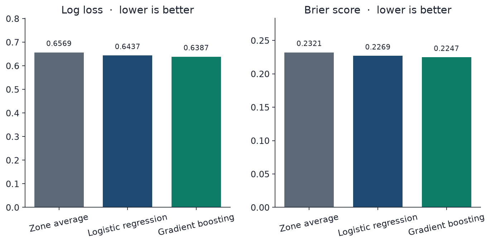

The boosted model’s log-loss gain over the zone average is 0.018. That is the gain from using distance, action, and the clock on top of the zone. It is not a different sport. It is a better probability, which is what expected points needs.

The zone model has the lowest calibration error because it only predicts a handful of rates, and those rates barely move year to year. The boosted model is close behind and much sharper. Mean predicted FG% on the holdout is 47.2%, against an actual 47.1%.

| When the boosted model says… | Shots | They went in… |
| --- | ---: | ---: |
| 37% (the 30–40% bin) | 93,670 | 36.1% |
| 44% | 64,728 | 44.8% |
| 75% | 13,696 | 75.1% |
| 93% | 6,690 | 94.2% |

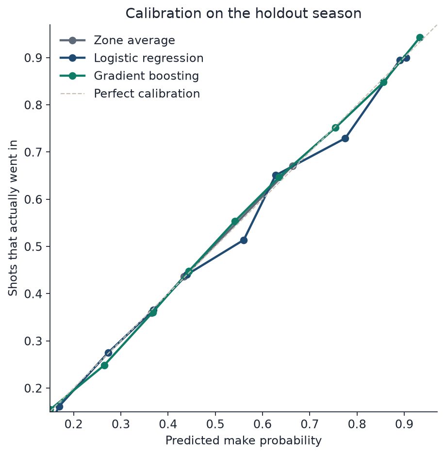

Distance carries 60.5% of the boosted model’s split gain. Action family carries 25.8%. Zone carries 5.7% once distance is available. The 2-point / 3-point flag carries almost none, because distance and zone already know the three-point line. That is collinearity, not “threes don’t matter.”

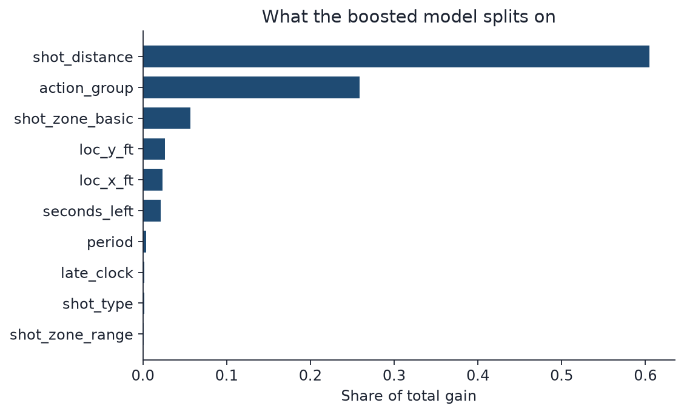

### What a shot is worth

Across three seasons, excluding heaves:

| Zone | Attempts | FG% | Avg distance | Points per shot |
| --- | ---: | ---: | ---: | ---: |
| Restricted area | 188,172 | 66.6% | 1.9 ft | 1.33 |
| Right corner 3 | 33,683 | 39.0% | 23.4 ft | 1.17 |
| Left corner 3 | 36,189 | 38.6% | 23.3 ft | 1.16 |
| Above the break 3 | 198,720 | 35.4% | 26.3 ft | 1.06 |
| Paint, outside the restricted area | 132,695 | 44.3% | 7.9 ft | 0.89 |
| Midrange | 66,718 | 41.7% | 15.8 ft | 0.83 |

A corner three at 39% beats a paint touch at 44% and a midrange jumper at 42%, because of the extra point. The holdout model prices the same geography: restricted area 1.33 expected points, corners about 1.16–1.17, above the break 1.07, non-restricted paint 0.89, midrange 0.84. League average on the holdout is **1.095** expected points per shot, and **1.091** actual points per shot.

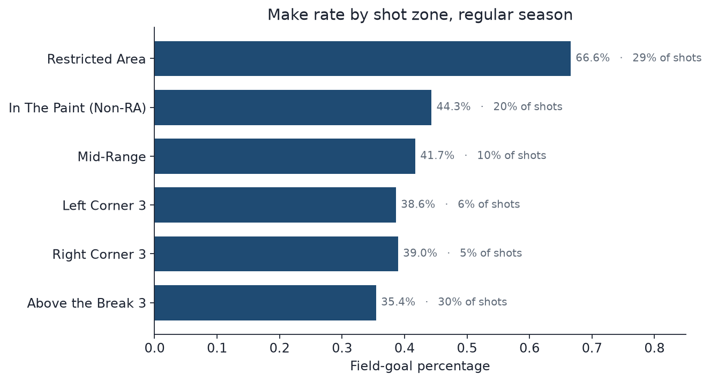

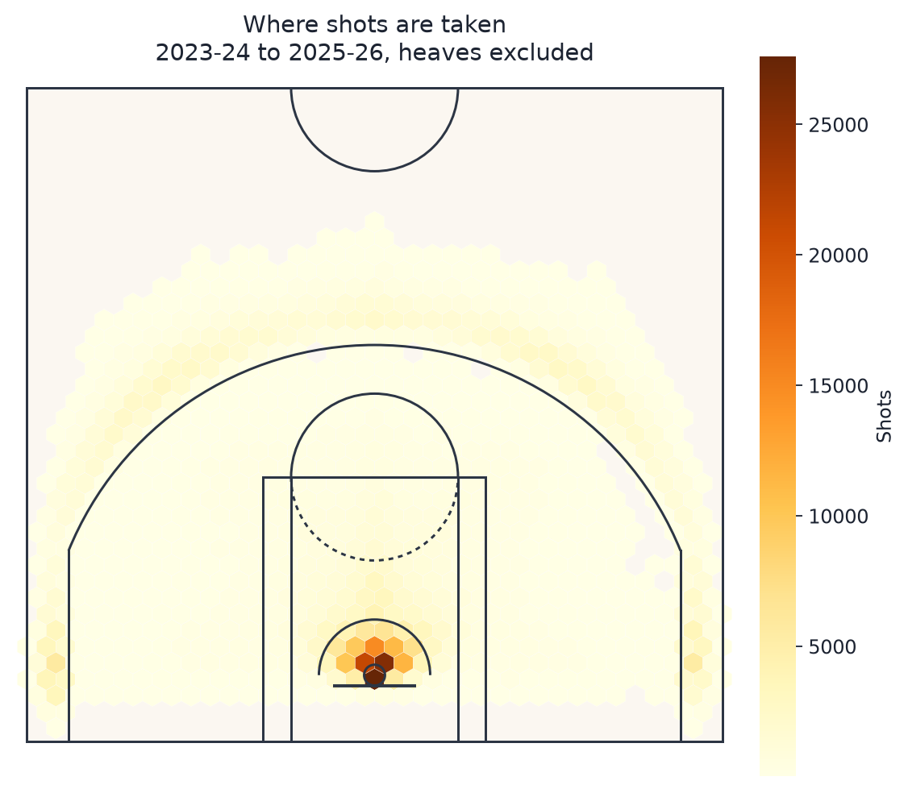

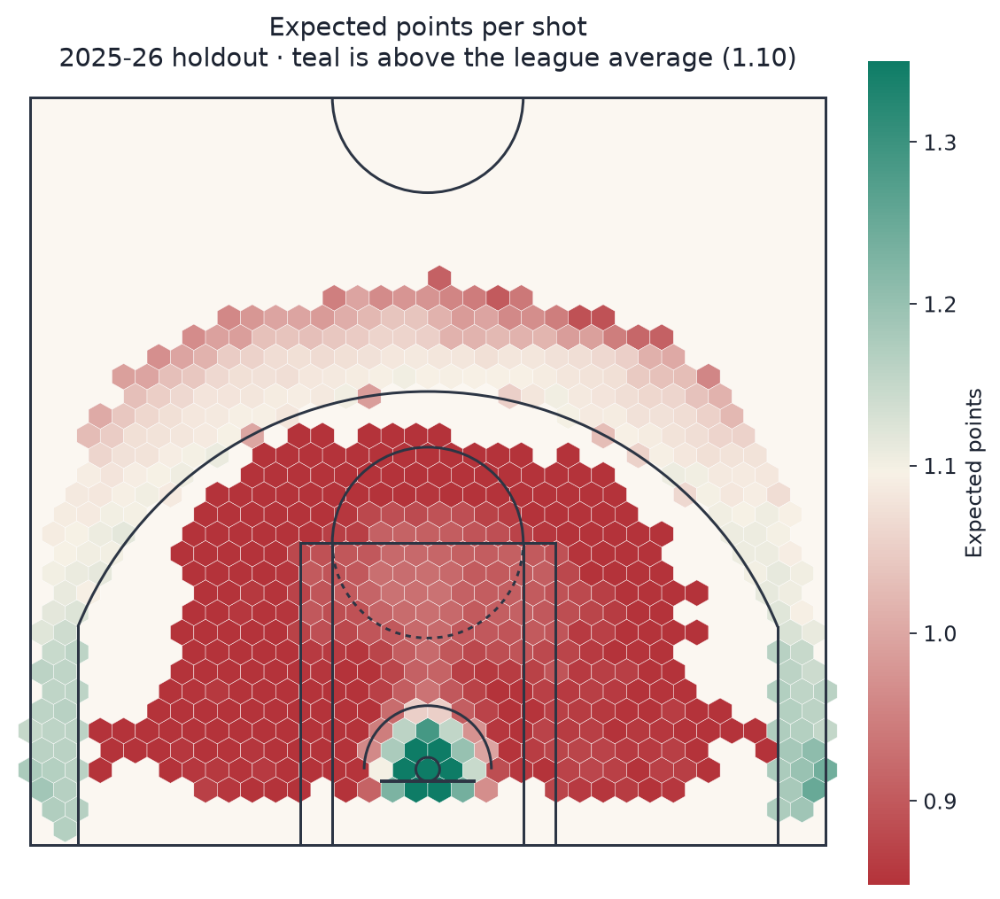

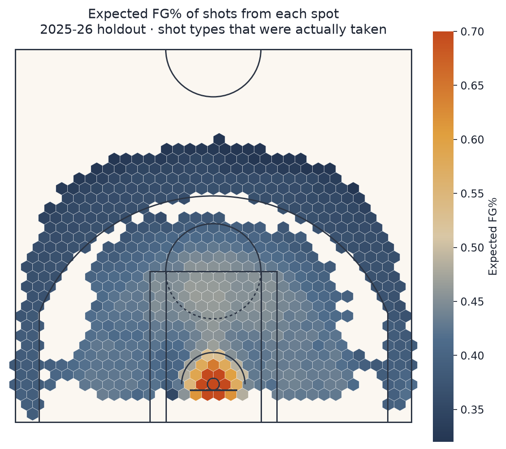

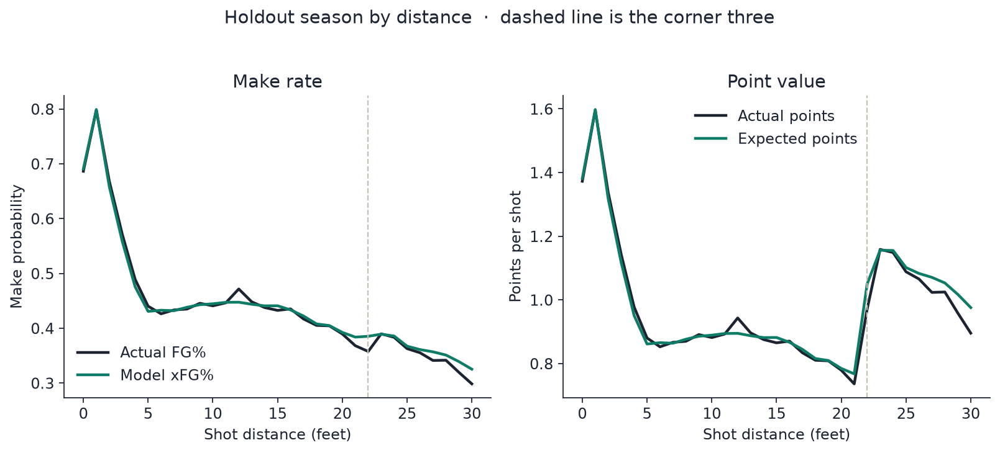

Above-the-break threes are the one place the holdout model is a little generous: 1.074 expected points against 1.051 actual. Everywhere else the zone-level actual and expected points sit within a few hundredths.

### Shot making over expected

Qualified players, 2025-26, shrunk points over expected per 100 shots. The raw number and its standard error are next to it so a 300-attempt season can be read honestly.

| Player | Team | FGA | FG% | xFG% | Selection / 100 | Raw POE / 100 | Shrunk POE / 100 | SE | Total POE |
| --- | --- | ---: | ---: | ---: | ---: | ---: | ---: | ---: | ---: |
| Luke Kennard | Atlanta Hawks | 443 | 53.3% | 42.7% | −3.6 | +27.1 | +19.2 | 5.6 | +120 |
| Nikola Jokić | Denver Nuggets | 1,130 | 56.8% | 46.7% | −6.9 | +20.7 | +17.9 | 3.5 | +234 |
| Kevin Durant | Houston Rockets | 1,375 | 52.1% | 43.8% | −9.9 | +18.1 | +16.0 | 3.2 | +249 |
| Shai Gilgeous-Alexander | Oklahoma City Thunder | 1,321 | 55.3% | 47.4% | −6.7 | +16.5 | +14.5 | 3.2 | +218 |
| Cam Spencer | Memphis Grizzlies | 556 | 47.3% | 40.6% | −6.9 | +18.3 | +13.8 | 5.0 | +102 |

| Player | Team | FGA | FG% | xFG% | Selection / 100 | Raw POE / 100 | Shrunk POE / 100 | SE | Total POE |
| --- | --- | ---: | ---: | ---: | ---: | ---: | ---: | ---: | ---: |
| Nae'Qwan Tomlin | Cleveland Cavaliers | 314 | 47.8% | 57.4% | +18.7 | −24.6 | −15.9 | 6.6 | −77 |
| Ben Saraf | Brooklyn Nets | 303 | 39.6% | 49.1% | −0.5 | −23.5 | −15.0 | 6.7 | −71 |
| Ronald Holland II | Detroit Pistons | 544 | 43.2% | 50.3% | +4.7 | −18.7 | −14.2 | 5.0 | −102 |
| Nikola Jović | Miami Heat | 314 | 36.6% | 44.8% | −0.4 | −21.6 | −14.0 | 6.6 | −68 |
| Herbert Jones | New Orleans Pelicans | 478 | 38.3% | 46.0% | +2.7 | −19.0 | −14.0 | 5.4 | −91 |

Kennard’s +27 per 100 is about five standard errors, so it is not a 40-shot fluke. It is still one season, on 443 attempts, with below-average shot quality. Jokić, Durant, and Gilgeous-Alexander clear their standard errors by a wide margin and add the most total points: Durant **+249**, Jokić **+234**, Gilgeous-Alexander **+218**.

Tomlin is the useful counterexample. His shots were excellent (+18.7 selection per 100) and he missed them (−24.6 raw). At 314 attempts the standard error is 6.6, so the miss is real for this season and still a thin sample.

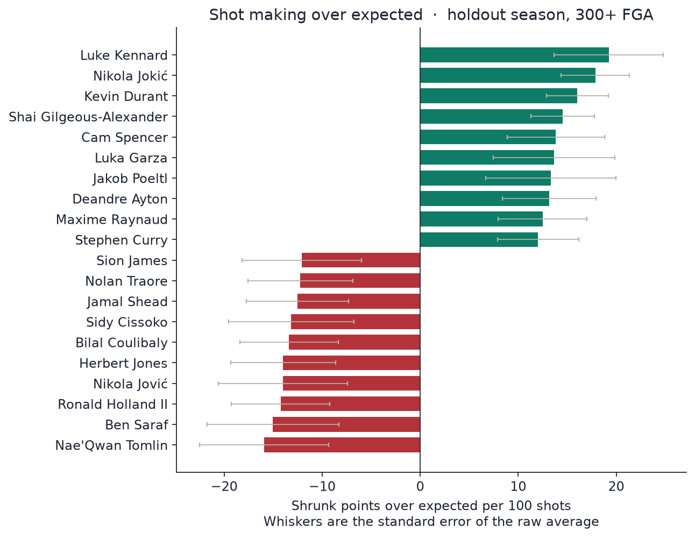

### Shot selection is a different skill

| Best shot diets | Team | FGA | xPTS / shot | Selection / 100 | Making / 100, shrunk |
| --- | --- | ---: | ---: | ---: | ---: |
| Rudy Gobert | Minnesota Timberwolves | 491 | 1.43 | +32.7 | −4.8 |
| Daniel Gafford | Dallas Mavericks | 316 | 1.33 | +22.9 | −1.5 |
| Collin Murray-Boyles | Toronto Raptors | 342 | 1.29 | +18.9 | −5.5 |
| Nae'Qwan Tomlin | Cleveland Cavaliers | 314 | 1.29 | +18.7 | −15.9 |
| Moussa Diabaté | Charlotte Hornets | 363 | 1.28 | +18.0 | −1.2 |

| Toughest shot diets | Team | FGA | xPTS / shot | Selection / 100 | Making / 100, shrunk |
| --- | --- | ---: | ---: | ---: | ---: |
| DeMar DeRozan | Sacramento Kings | 1,005 | 0.93 | −16.0 | +9.0 |
| T.J. McConnell | Indiana Pacers | 450 | 0.97 | −12.4 | +10.1 |
| Ryan Nembhard | Dallas Mavericks | 390 | 0.98 | −11.5 | −1.8 |
| Khris Middleton | Washington Wizards | 540 | 0.98 | −11.4 | −1.3 |
| Kevin Durant | Houston Rockets | 1,375 | 1.00 | −9.9 | +16.0 |

Gobert’s +33 is what it looks like when almost every touch is a dunk or a layup. The model already expects a dunk to go in (88.6% in the training data), so he does not also get a shot-making bonus for those dunks. His value in this framework is the diet. Take action type out of the model and the same player would be called a finisher. Both sentences can be true; they answer different questions. This project answers “given the kind of shot this was, did it go in more often than those shots go in?”

DeRozan and Durant take the other contract: harder shots, then more of them go in than the price. McConnell too, in a smaller sample.

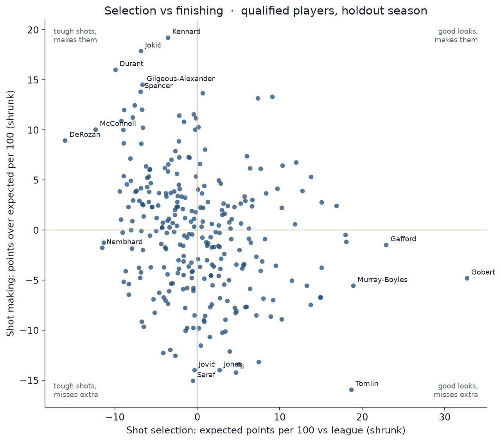

Jaylen Brown led the holdout in attempts (1,543). His shot diet was **−9.4** per 100 versus the league. His finishing was **+3.9** per 100 after shrinkage. The chart below is colored by expected FG%, not by make or miss.

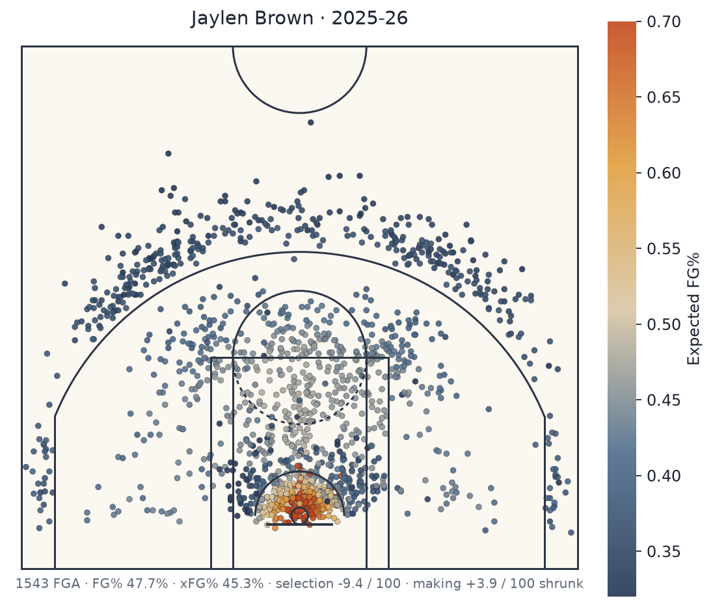

### Teams

Team shot-making, 2025-26. Twelve of 30 teams sit more than two standard errors from zero. The middle of the table is noise.

| Team | FGA | xPTS / shot | Selection / 100 | Making / 100 | SE | Total POE |
| --- | ---: | ---: | ---: | ---: | ---: | ---: |
| Denver Nuggets | 7,190 | 1.076 | −1.9 | +7.6 | 1.4 | +547 |
| Los Angeles Lakers | 6,862 | 1.086 | −0.9 | +6.0 | 1.4 | +411 |
| Boston Celtics | 7,397 | 1.055 | −4.1 | +5.1 | 1.4 | +377 |
| Los Angeles Clippers | 6,854 | 1.081 | −1.4 | +3.6 | 1.4 | +250 |
| Milwaukee Bucks | 7,011 | 1.102 | +0.7 | +2.9 | 1.4 | +204 |

| Team | FGA | xPTS / shot | Selection / 100 | Making / 100 | SE | Total POE |
| --- | ---: | ---: | ---: | ---: | ---: | ---: |
| Brooklyn Nets | 6,931 | 1.107 | +1.2 | −6.6 | 1.4 | −460 |
| New Orleans Pelicans | 7,419 | 1.119 | +2.4 | −6.4 | 1.4 | −478 |
| Portland Trail Blazers | 7,386 | 1.127 | +3.1 | −5.9 | 1.4 | −438 |
| Chicago Bulls | 7,415 | 1.138 | +4.3 | −4.3 | 1.4 | −322 |
| Philadelphia 76ers | 7,401 | 1.098 | +0.3 | −3.7 | 1.4 | −277 |

Denver’s shots were slightly below league quality and went in far more often than that price. Chicago had the best shot diet in the league (+4.3 per 100) and gave it back in finishing (−4.3). Boston’s diet was the second-toughest (−4.1) and the finishing was still +5.1. Sacramento had the toughest team diet (−5.8), with DeRozan’s midrange in it, and finished near even on making.

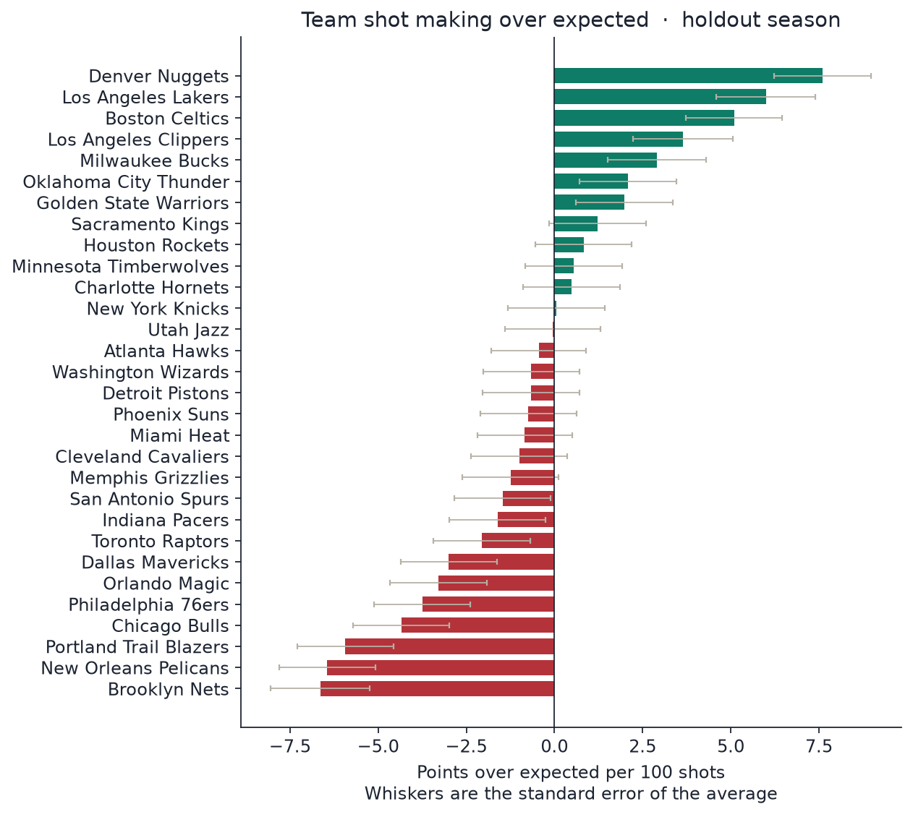

## Limitations

- There is no defender distance, contest, or closest defender. A wide-open 26-footer and a late-clock 26-footer share a location. The action label and the game clock pick up some of that, not the defense.
- There is no shot clock. `late_clock` is the game clock inside four seconds.
- Who is on the floor, and who created the shot, are not in the row. A center’s dunk and a guard’s dump-off are both “dunk.”
- Putting dunks and layups in the model moves finishing skill into the shot-quality side. Gobert’s section above is that choice, stated with a number.
- One holdout season is one season. Kennard at +19 per 100 is a real 2025-26 result. It is not a career prior.
- Shrinkage is a normal approximation estimated by method of moments. It is the right shape (small samples move more) and it is not a full hierarchical model.
- The 2025-26 mirror is thin on 40-foot heaves. Those shots are excluded.
- Logistic coefficients are a bad place to read “the effect of distance.” Distance, zone, and coordinates describe the same geometry. Use the zone table and the distance chart for interpretation, and the model for probabilities.
- Team totals mix shooting, creation, and opponent. They are not a coaching grade.

## Next steps

- Defender distance and shot clock, if the tracking feed is available. That is the feature that would change a front-office model.
- Out-of-fold predictions across several seasons, so a career estimate is not one hot year.
- Put the partial pooling inside the model (a hierarchical logistic regression or a player effect with a strong prior) instead of shrinking the residuals afterward.
- Isotonic calibration fit on the validation slice only, checked on the next season, if the probabilities were going to be priced.
- A version with action type removed, reported beside this one, so “finisher” and “shot diet” can be shown as the two answers they are.

## How to run

Python 3.11 or newer. `.python-version` is 3.11. Streamlit Community Cloud does not read that file; set Python 3.11 in the deploy dialog under Advanced settings. The entry point is `app/streamlit_app.py` on `main`.

```bash
python -m venv .venv
source .venv/bin/activate
pip install -r requirements.txt
streamlit run app/streamlit_app.py --server.port 8741
```

`requirements.txt` is what Community Cloud installs: the app and the libraries it imports. Training, the notebook, and the tests use `requirements-dev.txt`.

```bash
pip install -r requirements-dev.txt
pip install -e .
python scripts/pull_shots.py          # uses data/raw if it is already cached
python scripts/run_pipeline.py        # trains, writes figures, DuckDB, leaderboards, data/app
pytest
jupyter notebook notebooks/shot_quality_analysis.ipynb
```

The raw and processed shot files (`data/raw/*.parquet`, `data/processed/*.parquet`, and `data/processed/shots.duckdb`) are regenerated by `python scripts/pull_shots.py` and then `python scripts/run_pipeline.py`. Run those two commands when those files are missing, including from the portable archive, which omits them to stay under 20 MB. `pull_shots.py` writes the raw season files. The pipeline cleans them and writes the DuckDB database, the scored shots, the leaderboards, and the compact `data/app/` extract. Figures, `metrics.json`, the notebook, and the README tables are already in the tree. `data/app/` is committed; the raw and full processed tables are not.

`scripts/pull_shots.py --source api` tries a live `ShotChartDetail` pull (30 teams × 3 seasons, cached, with a pause between calls). `--source mirror` skips the probe and uses SportsDataverse. The default, `--source auto`, uses the cache when the parquet files are already there.

The Streamlit app asks for a player and draws their 2025-26 shots colored by xFG%, with FG%, xFG%, shot selection, and points over expected. It does not refit, and it does not download data when it starts. It reads `data/processed/` when the full scored table and leaderboards are present, and the committed extract in `data/app/` otherwise. That extract keeps every player and team on the leaderboards, with shot rows limited to the columns the chart uses. After `streamlit run` starts, open the local URL printed in the terminal. Put the public URL on the Live app line at the top of this file.

Figures in this README are files in `figures/`, linked with relative paths such as `figures/calibration.png`, so they render on GitHub.

`LEARNING_NOTES.md` walks the same pipeline in plain language, with questions an interviewer will actually ask.

## Repository map

```
src/shotquality/
  data/            pull, clean, DuckDB
  features/        zones, action families, the allowed column list, the split
  models/          zone baseline, logistic regression, LightGBM, metrics, shrinkage
  analysis/        SQL and leaderboards
  viz/             half-court drawing and figures
  pipeline.py      one-command run
scripts/pull_shots.py
scripts/run_pipeline.py
app/streamlit_app.py
notebooks/shot_quality_analysis.ipynb
tests/
figures/
data/raw/          cached shot files
data/processed/    parquet, DuckDB, metrics.json, leaderboards
data/app/          compact extract the Streamlit app ships with
models/            saved baseline, logistic regression, LightGBM
```

Numbers in this README come from `data/processed/metrics.json` produced by `scripts/run_pipeline.py`. Percentages are rounded to one decimal. Log loss and Brier score are rounded to four decimals.
